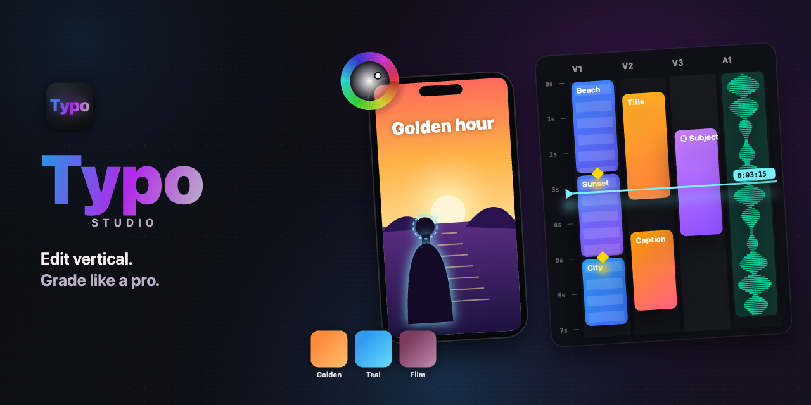

<p align="center">
  
</p>

<p align="center">
  <b>The vertical-first video editor for Reels, Shorts and TikTok — with pro colour, AI subject tools and Claude built in.</b>
</p>

<p align="center">
  <a href="../../releases/latest"></a>
  
  
  
</p>

<p align="center">
  <a href="#-features">Features</a> ·
  <a href="#-install">Install</a> ·
  <a href="#-claude--mcp">Claude & MCP</a> ·
  <a href="#-keyboard">Keyboard</a> ·
  <a href="#-faq">FAQ</a>
</p>

---

## ✨ Features

<table>
<tr>
<td width="50%" valign="top">

### 🎞 Edit vertically
- **Vertical timeline** — time runs down, tracks sit side by side, made for 9:16
- **Horizontal editing** too — one switch for 16:9 work
- Frame-accurate scrubbing, ripple, split, groups and links
- **Multi-select**, box-select and **time ranges** (⌥-drag the ruler)
- **Collage build** — clips arrive one by one and the frame re-flows (14 layouts)
- **Picture-in-picture** windows in 12 shapes, drag to move and resize
- **Export each clip** as its own file

</td>
<td width="50%" valign="top">

### 🎨 Grade like a pro
- Lumetri-style Adjust · Style · LUT · Masks, wheels and curves
- **75+ camera & film looks** — Fujifilm-, Sony-, Canon- and ARRI-style, film stocks
- **47 one-tap filters** plus your own custom filters
- Clarity and texture per tone (shadows · midtones · highlights)
- **Log footage** in: S-Log3, LogC3/4, C-Log2/3, V-Log, F-Log, N-Log, Apple Log, D-Log, HLG
- A **colour assistant** that reads the scopes and fixes exposure, casts and skin

</td>
</tr>
<tr>
<td width="50%" valign="top">

### 🧍 AI subjects (Apple Vision, on device)
- **Detect** a subject, faces, people or any object you paint
- Each detection becomes its **own track** — grade it, add effects, put text behind it
- **Subject transitions** — the subject from the last frame stays on screen over the next clip
- Crisp edges, live tracking with a brush

</td>
<td width="50%" valign="top">

### ✍️ Titles, effects & sound
- Text and titles on their own tracks, with styles and animation
- 360+ transitions, 190 tyFX effects, 270+ overlays, light leaks
- Speed ramps, freeze frames, fades, masks and stabilise
- Voice-over recording from any mic (built-in, USB, Bluetooth)
- RAW photos (DNG, CR3, NEF, ARW, RAF…) and log video

</td>
</tr>
</table>

---

## 📦 Install

1. Download **`Typo-1.0.0-arm64.dmg`** from the [latest release](../../releases/latest).
2. Open it and drag **Typo** into **Applications**.
3. The first time: right-click **Typo** → **Open** → **Open**.

> [!NOTE]
> Typo isn't notarised by Apple yet, so macOS asks once. If it says the app is *damaged*, run this once in Terminal:
> ```bash
> xattr -dr com.apple.quarantine /Applications/Typo.app
> ```

**Requires** an Apple silicon Mac (M1 or later). Subject detection needs macOS 14 or newer.

---

## 🤖 Claude & MCP

Typo connects to Claude both ways — open **Typo › Settings… › Connections**.

| | What it does | How |
|---|---|---|
| **Claude in Typo** | Type `ask …` in the command bar — *“ask make this punchier for Instagram”* — and Claude reads your edit and makes the changes with Typo's own commands. | Paste your Anthropic API key (encrypted on your Mac), pick a model. |
| **Typo in Claude Code** | Claude Code can run commands, read the timeline and look at the preview. | Switch on the MCP server, then run the line Typo shows you: `claude mcp add --transport http typo http://127.0.0.1:7393/mcp --header "Authorization: Bearer …"` |
| **Typo in Claude Desktop** | The same tools inside Claude Desktop. | Copy the JSON Typo shows into *Settings › Developer › Edit Config*. |
| **Any MCP client** | Standard MCP (Streamable HTTP) on `127.0.0.1`, token-protected. | Same URL and token. |

<details>
<summary><b>MCP tools Typo offers</b></summary>

| Tool | |
|---|---|
| `typo_command` | Run any Typo command (split, add text, filter, grade, detect, collage, export…) |
| `typo_state` | The timeline: every item, its track, times and effects |
| `typo_help` | Every command Typo understands |
| `typo_select` · `typo_seek` | Select an item · move the playhead |
| `typo_preview` | A screenshot of the window |

</details>

---

## ⌨️ Keyboard

| Keys | Action | Keys | Action |
|---|---|---|---|
| <kbd>Space</kbd> | Play / pause | <kbd>,</kbd> <kbd>.</kbd> | One frame back / forward (<kbd>⇧</kbd> ten) |
| <kbd>S</kbd> | Split at the playhead | <kbd>⌫</kbd> / <kbd>⇧</kbd><kbd>⌫</kbd> | Delete / ripple delete |
| <kbd>⌘</kbd><kbd>A</kbd> | Select everything | <kbd>⇧</kbd>-drag | Box-select |
| <kbd>⌥</kbd>-drag the ruler | Mark a time range | <kbd>⇧</kbd><kbd>D</kbd> | Default transition |
| <kbd>⌘</kbd><kbd>Z</kbd> / <kbd>⇧</kbd><kbd>⌘</kbd><kbd>Z</kbd> | Undo / redo | <kbd>⌘</kbd><kbd>,</kbd> | Settings |

---

## 💧 Watermark

Exported videos carry a small **“made with Typo”** mark. Enter your **TyKey** in *Settings › TyKey* to export without it.

---

## ❓ FAQ

<details>
<summary><b>Is my footage uploaded anywhere?</b></summary>

No. Editing, subject detection (Apple Vision) and exports all run on your Mac. Only “ask Claude” sends your request and the timeline's description to Anthropic, and only when you use it with your own API key.
</details>

<details>
<summary><b>Windows or Intel Macs?</b></summary>

Not yet — Typo uses Apple-silicon-only tools for subject detection and editing copies.
</details>

<details>
<summary><b>Scrubbing 4K feels heavy</b></summary>

Typo makes light 1080p editing copies of big files in the background (progress shows on the clip's tile). Exports always use your originals.
</details>

---

<p align="center"><sub>Typo Studio · made for vertical video</sub></p>
